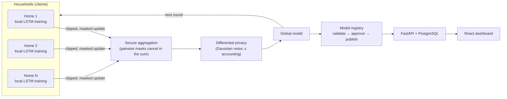

# Privacy-Preserving Household Energy Forecasting with Federated Learning

Forecasting a household's electricity use for the next 24 hours **without collecting every home's raw smart-meter data in one place**.

Each household trains a shared forecasting model on its own data and sends only model updates. The server combines those updates with **secure aggregation**, so it sees only the sum and never an individual home's update. It then adds **differential privacy** noise, so the final model reveals as little as possible about any single home. Households see their forecasts and saving recommendations in a web dashboard. Administrators run and approve training from the same dashboard.

## What I built

| Part | Technology | What it does |
|---|---|---|
| **Trainer** | Python, PyTorch | Generates a realistic synthetic dataset (96 homes × 1 year, half-hourly), imports real smart-meter data, adds weather and calendar features, runs federated training with secure aggregation and differential privacy, and trains a centralized baseline for comparison |
| **Model** | 2-layer LSTM (55,736 parameters) | Reads the last 168 hours (10 features per hour) and predicts the next 24 hours of consumption |
| **API** | FastAPI, PostgreSQL, Alembic | JWT login with refresh-token rotation, password hashing, rate limiting, admin workflows, and a model registry (validate → approve → publish) |
| **Dashboard** | React, TypeScript, Vite | Admin view for datasets, training runs, round metrics and models. Household view for history, forecasts and recommendations |
| **Infrastructure** | Docker Compose (optional GPU) | Runs the whole stack with one command. Raw household data is mounted only into the trainer, never the API |

## How it works

**Inputs per hour (10 features):** consumption, temperature, feels-like temperature, precipitation (from Open-Meteo), hour of day and day of week (sine/cosine encoded), weekend flag and Irish public-holiday flag.

## Results

All errors are in real kWh per forecasted hour. For all metrics, lower is better. ε is the differential-privacy budget (δ = 1e-5), where a smaller ε means stronger privacy.

**Synthetic dataset (96 households, 1 year):**

| Run | Privacy | Rounds | ε | Federated MAE | Centralized MAE |
|---|---|---|---|---|---|
| Tuned, no DP | Secure aggregation | 5 | ∞ | **0.315** | 0.219 |
| Tuned, with DP | Secure aggregation + DP | 5 | 10.94 | 0.578 | 0.223 |
| Evaluation, with DP | Secure aggregation + DP | 3 | 8.04 | 0.574 | 0.231 |

**London smart-meter dataset (96 real households):** federated MAE 0.650 kWh vs. centralized 0.402 kWh, with secure aggregation and DP (ε ≈ 10.94), trained on GPU.

**Takeaways**
- Federated training converged steadily over the rounds and came within about 0.1 kWh of centralized training when no DP noise was added.
- Adding differential privacy roughly doubled the error. That's the expected privacy–utility trade-off, and the main thing to improve next.
- Secure aggregation cost no accuracy: the masks cancel exactly, with a maximum error of about 2e-10.

## Honest limitations

- Federated learning is **simulated**: all clients run inside one trainer process, not on separate devices over a network.
- Secure aggregation is a prototype pairwise-masking scheme. It doesn't recover from clients dropping out mid-round.
- Feature scaling statistics are computed over all clients' training data. A fully federated version would compute them with secure aggregation too.
- Only one model architecture (LSTM) was studied. Full privacy–utility curves over a range of ε values are future work.

## Repository guide

- `trainer/`: data generation and import, preprocessing, model, federated training, privacy, publishing
- `api/`: backend service and database migrations
- `web/`: dashboard
- `docs/`: project proposals, final report, and UML/use-case diagrams ([system class diagram](docs/diagrams/system-class-diagram.png))
- Branch [`april-simulated-version`](../../tree/april-simulated-version): the earlier version using only the synthetic dataset

---

# Running the project

This is an end-to-end monorepo for a privacy-preserving household energy forecasting prototype with:

- `api`: FastAPI + PostgreSQL app for auth, admin workflows, dashboards, model registry, and snapshots
- `trainer`: PyTorch federated training worker for dataset import, preprocessing, secure aggregation, DP accounting, weather sync, and publication
- `web`: React + TypeScript/Vite dashboard for household and admin users

## Profiles

- `fixture`: fully local stack using a larger realistic synthetic dataset generated by the trainer
- `cer-dev`: sampled CER workflow using mounted approved raw data
- `cer-full`: full CER workflow using mounted approved raw data
- `smart-meters`: London smart-meter workflow using `data/artifacts/datasets/smart-meters` or a custom dataset root

## Quick start

1. Copy `.env.example` to `.env` and adjust paths if needed.
2. Install dependencies:
   - `cd api && uv sync`
   - `cd trainer && uv sync`
   - `cd web && npm install`
3. Start the stack:
   - `docker compose --profile fixture up --build`
4. Open:
   - Web: `http://localhost:5173`
   - API docs: `http://localhost:8000/docs`
5. Log in:
   - Admin: `admin@demo.local` / `Admin123!`
   - Fixture household: `household-0001@demo.local` / `Household123!`

## Dashboard walkthrough

The full stack is visible from the admin dashboard.

1. Start the fixture stack:
   - `docker compose --profile fixture up --build`
2. Open `http://localhost:5173`
3. Sign in as `admin@demo.local` / `Admin123!`
4. In `Operations`:
   - `Queue dataset import`
   - `Sync weather`
   - `Create FL run`
5. Inspect the run:
   - `Training Runs` shows status and MAE
   - `Round Metrics` shows per-round metrics, bytes transferred, and secure aggregation metadata
   - `Model Registry` lets you validate, approve, and publish
   - `Household Access` shows invite activation links for non-seeded users
6. Open a household dashboard:
   - sign in as `household-0001@demo.local` / `Household123!`, or
   - use an activation URL from `Household Access`, then sign in with the activated account

## Local development

Run the services in separate terminals:

- `make api-dev`
- `make trainer-dev`
- `make web-dev`

Then open:

- Web dashboard: `http://localhost:5173`
- API docs: `http://localhost:8000/docs`

## Training commands

Full fixture bootstrap with secure aggregation enabled:

- `cd trainer && uv run python -m trainer.cli.main bootstrap-fixture --households 96 --days 365 --secure-aggregation-degree 2 --secure-aggregation-mask-scale 4.0`

Fixture evaluation with DP-on and DP-off experiments:

- `cd trainer && APP_PROFILE=fixture uv run python -m trainer.cli.main evaluate-fixture --households 12 --days 120 --rounds 5 --local-epochs 2 --batch-size 64 --learning-rate 0.001 --secure-aggregation-degree 2 --secure-aggregation-mask-scale 4.0 --publish-dp-on`

CER bootstrap with secure aggregation:

- `cd trainer && APP_PROFILE=cer-dev uv run python -m trainer.cli.main bootstrap-cer --profile cer-dev --sample-households 12 --rounds 5 --local-epochs 2 --batch-size 64 --learning-rate 0.001 --secure-aggregation-degree 2 --secure-aggregation-mask-scale 4.0`

Smart-meter bootstrap with secure aggregation:

- `cd trainer && APP_PROFILE=smart-meters uv run python -m trainer.cli.main bootstrap-smart-meters --sample-households 12 --rounds 5 --local-epochs 2 --batch-size 64 --learning-rate 0.001 --secure-aggregation-degree 2 --secure-aggregation-mask-scale 4.0`

Disable secure aggregation only if you are doing ablation/debugging:

- add `--no-secure-aggregation`

## GPU Training

The trainer now auto-selects CUDA when it is available.

- Host mode: `cd trainer && TRAINER_DEVICE=auto uv run python -m trainer.cli.main worker`
- Force CPU: `cd trainer && TRAINER_DEVICE=cpu uv run python -m trainer.cli.main worker`
- Docker GPU mode: `docker compose -f docker-compose.yml -f docker-compose.gpu.yml --profile fixture up -d trainer`

The Docker GPU path requires the NVIDIA container runtime on the host. If Docker reports that no GPU vendor or CDI device is available, the host driver is present but the NVIDIA container toolkit is not configured for Docker yet.

## Fixture Evaluation Workflow

Use the synthetic fixture profile to produce a side-by-side DP comparison without any restricted external data.

1. Ensure `.env` is using `APP_PROFILE=fixture`.
2. Run `make fixture-evaluate`
3. Review the generated artifacts under `data/artifacts/reports`

The evaluation command generates a realistic synthetic multi-household dataset, syncs weather, runs two FL experiments (`dp_on` and `dp_off`), records forecast accuracy and communication metrics, writes JSON and Markdown comparison reports, and publishes the `dp_on` model back into the household dashboard.

## CER Dev Workflow

`cer-dev` is intended for approved CER data mounted into the trainer only.

1. Update `.env`:
   - `APP_PROFILE=cer-dev`
   - `RAW_DATA_DIR=./data/raw/issda`
   - `ISSDA_DATAVERSE_API_KEY=...` if you have authorized ISSDA download access
2. Download the CER package:
   - Public docs and metadata only: `make cer-download`
   - Restricted smart meter archives as well: set `ISSDA_DATAVERSE_API_KEY` first, then run `make cer-download`
3. Ensure the mounted dataset path contains either:
   - a directory with `readings.csv` and optional `households.csv`, or
   - the original CER-style `File1.txt.zip` ... `File6.txt.zip` trial files with optional allocation metadata, or
   - a direct path to `readings.csv`
4. Start the stack:
   - `make cer-dev-stack`
5. Choose one of the two operator paths:
   - Admin UI: log in as `admin@demo.local` / `Admin123!`, queue a `CER` dataset import from the Operations panel, then queue weather sync, create a run, approve the model, and publish it.
   - Trainer CLI: `make cer-dev-bootstrap`

The trainer bootstrap command imports the mounted CER data, syncs weather, runs FL training, validates and approves the model, and publishes household snapshots in one pass. If `RAW_DATA_DIR` contains only the public ISSDA documents, the importer now fails with a specific message telling you that the restricted smart meter archives are still missing.

## Smart-Meter Workflow

`smart-meters` imports the London smart-meter dataset from the trainer only.

1. Update `.env`:
   - `APP_PROFILE=smart-meters`
   - `SMART_METER_DATA_DIR=./data/artifacts/datasets/smart-meters`
2. Ensure the dataset root contains:
   - `informations_households.csv`
   - `halfhourly_dataset/.../block_*.csv`
3. Choose one of the two operator paths:
   - Admin UI: log in as `admin@demo.local` / `Admin123!`, queue a `Smart meters dataset` import from the Operations panel, then queue weather sync, create a run, approve the model, and publish it.
   - Trainer CLI: `make smart-meter-bootstrap`

The smart-meter importer converts half-hourly readings to hourly household series, carries tariff and ACORN metadata into the household registry, defaults weather geolocation to London, and marks the holiday calendar as `GB` for model feature generation.

## Local commands

- `make api-dev`
- `make trainer-dev`
- `make web-dev`
- `make test`
- `make fixture-stack`
- `make fixture-evaluate`
- `make cer-dev-stack`
- `make cer-download`
- `make cer-dev-bootstrap`
- `make smart-meter-bootstrap`

## Demo accounts

Both fixture and CER bootstrap paths seed:

- Admin: `admin@demo.local` / `Admin123!`

Only the fixture bootstrap seeds an active household password:

- Household: `household-0001@demo.local` / `Household123!`

Other households are invite-based and can now activate through `/activate?token=...` using the activation token shown in the admin household table.

CER imports create invite-based household accounts and expose activation tokens in the admin household table.

## Privacy boundary

Raw household data is read only by the trainer from `data/raw` and `data/fixture`. The API and Postgres do not mount the raw-data volume. Only approved summaries, forecasts, recommendations, and run metadata are written to the shared database.

Federated runs now use secure aggregation by default. The current implementation is a strong prototype for this monorepo: client deltas are pairwise masked before aggregation, the masks cancel only in the global sum, and DP noise is applied after the masked aggregate is recovered. It is not a distributed threshold-MPC deployment with dropout recovery, so it should be described as secure-aggregation support for the simulated trainer rather than a production cryptographic system.
