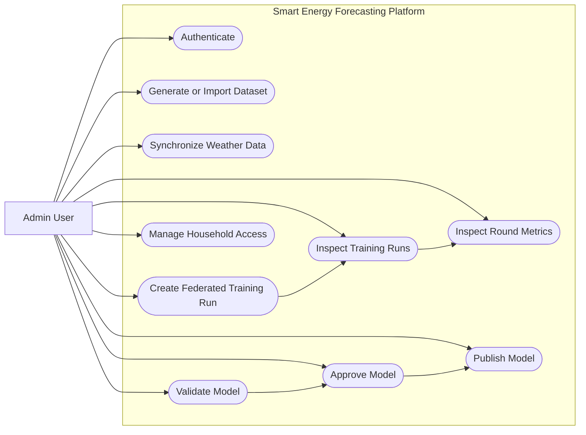
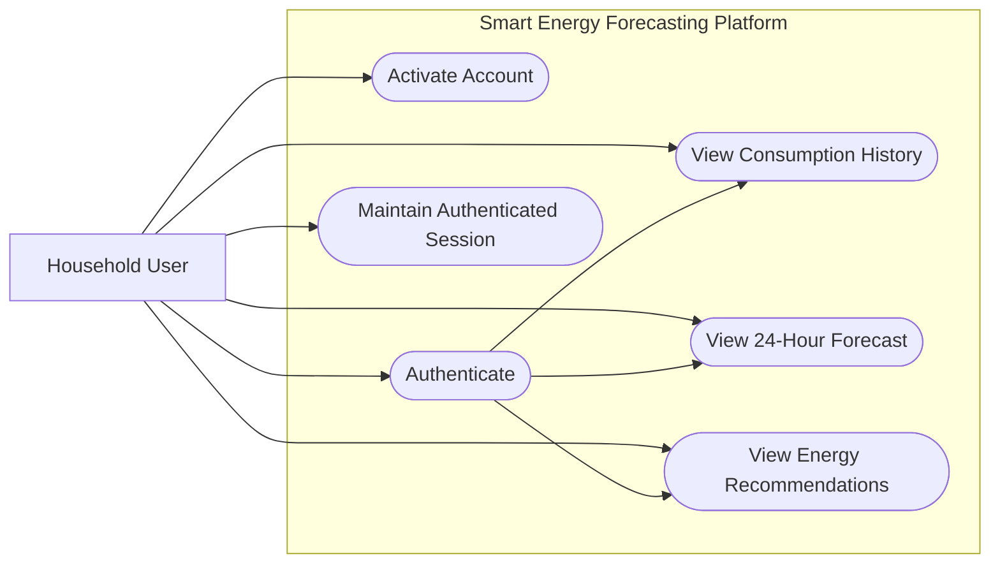
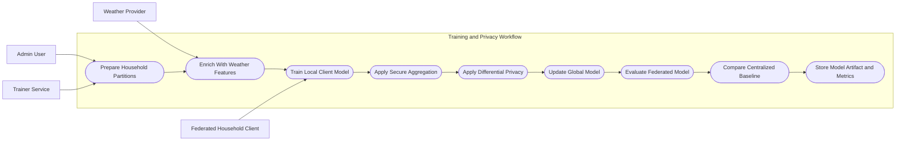

 Final Project Report

Date: 2026-04-05

1. Abstract

This report documents the final implemented state of the federated smart energy forecasting project contained in this repository. The delivered system focuses on household energy forecasting and provides an end-to-end workflow covering dataset preparation, weather enrichment, federated model training, centralized baseline comparison, privacy accounting, secure aggregation support in simulation, model governance, and publication of approved outputs to a web dashboard.

The implemented platform consists of:

- a FastAPI backend for authentication, authorization, admin operations, model lifecycle management, and household snapshot delivery
- a trainer service for synthetic data generation, CER-style dataset import, preprocessing, federated training, differential privacy accounting, secure aggregation, weather synchronization, and snapshot publication
- a React dashboard for admin users and household users
- local development and Docker-based deployment workflows

The strongest persisted utility result currently available is a non-private federated run with:

- Mean Absolute Error (MAE): 0.3153 kWh
- Root Mean Squared Error (RMSE): 0.4153 kWh
- Mean Absolute Percentage Error (MAPE): 41.65%

The corresponding centralized baseline for that run achieved:

- MAE: 0.2186 kWh

The strongest persisted private result currently available is:

- MAE: 0.5744 kWh
- epsilon: 8.039

These results show that the system is functionally complete as a prototype, while also showing that the current differential privacy configuration produces a substantial accuracy reduction relative to the best non-private federated run and the centralized baseline.

2. Project Scope

2.1 Delivered Scope

The final delivered implementation includes:

- household energy forecasting
- realistic synthetic dataset generation
- CER-style smart meter dataset ingestion
- chronological preprocessing and window creation
- weather enrichment and fallback weather synthesis
- federated training simulation across household partitions
- centralized baseline training for direct comparison
- differential privacy accounting
- secure aggregation support in the aggregation path
- model versioning, validation, approval, and publication
- admin and household dashboards
- automated tests for API and trainer workflows

2.2 Implemented Focus

The repository implements the energy forecasting portion of the broader project concept. The current codebase does not implement a traffic prediction pipeline. All persisted benchmark results in the repository are from the energy forecasting workflow.

3. System Architecture

3.1 Services

- api
  FastAPI application for authentication, admin workflows, household data access, and model governance.
- trainer
  Background worker and command-line service for dataset generation/import, preprocessing, weather sync, training, evaluation, and publication.
- web
  React and TypeScript dashboard for administration and household access.
- postgres
  Shared persistence layer when the Docker stack is used.

3.2 Data Boundary

The architecture separates raw data access from dashboard-facing services:

- raw meter data is read and processed by the trainer
- the API and database store only processed metadata, model records, run records, and published snapshots
- household dashboards consume published history, forecast, and recommendation snapshots rather than raw readings

This boundary is central to the privacy-aware design of the system.

3.3 End-to-End Workflow

1. Generate or import a dataset.
2. Normalize readings and construct household time series.
3. Enrich the dataset with weather features.
4. Partition households into federated clients.
5. Train the forecasting model through the federated loop.
6. Compare against a centralized baseline.
7. Validate, approve, and publish the resulting model.
8. Serve published outputs to the dashboard.

3.4 Use Case Diagrams

The following diagrams summarize the primary actors and system use cases.

3.4.1 Admin Operations Use Case Diagram

3.4.2 Household User Use Case Diagram

3.4.3 Training and Privacy Use Case Diagram

3.4.4 System Class Diagram

The class diagram shows the main actors, application components, data entities, model components, and privacy components used by the platform. The editable Mermaid source and exported PDF version are stored in the project diagram folder.

4. Backend and Database Implementation

4.1 API Capabilities

The backend currently supports:

- login
- logout
- token refresh
- current-user lookup
- household account activation
- dataset import job creation
- weather synchronization job creation
- training run creation and cancellation
- retrieval of per-round training metrics
- model validation, approval, and publication
- household history retrieval
- household forecast retrieval
- household context retrieval
- household recommendation retrieval

4.2 Authentication and Session Management

The authentication flow includes:

- password hashing with argon2id
- password strength validation
- JWT access tokens
- JWT refresh tokens
- rotating refresh sessions
- replay detection for reused refresh tokens
- token-family revocation on refresh-token misuse
- activation-token based onboarding for invited household accounts

4.3 Additional Security Controls

Additional controls currently implemented include:

- role-based access control for admin and household users
- audit log entries for key authentication and model-governance actions
- in-memory sliding-window rate limiting
- HTTP security headers including X-Frame-Options, X-Content-Type-Options, Referrer-Policy, and Cache-Control: no-store

4.4 Database Coverage

The data model includes:

- households
- users
- user sessions
- dataset versions
- jobs
- training runs
- training round metrics
- model versions
- household summary snapshots
- forecast snapshots
- recommendation snapshots
- audit logs

4.5 Model Governance

Model lifecycle states are enforced operationally:

1. a model is created from a completed training run
2. an administrator validates the model
3. an administrator approves the model
4. an approved model is published to generate household-facing snapshots

5. Data Pipeline

5.1 Synthetic Dataset Generator

The project includes a large synthetic dataset generator for local experimentation and demonstration.

Key characteristics:

- 30-minute interval readings
- default generation size of 96 households and 365 days
- household archetypes representing different occupancy and usage behaviors
- region-specific variation
- occupancy-driven demand changes
- heating and water-heating demand
- cooking peaks
- dishwasher and laundry events
- electric vehicle charging events
- rooftop solar offsets
- vacation periods
- correlated stochastic noise

This generator is intended to produce realistic development data without requiring external restricted datasets.

5.2 External Dataset Support

The trainer supports:

- normalized compact datasets via readings.csv
- CER-style archive imports using File*.txt.zip
- optional household metadata and allocation metadata

The importer also identifies incomplete ISSDA downloads that contain documentation or metadata but not the restricted reading archives, and returns a specific error message for that case.

5.3 Preprocessing

The preprocessing pipeline performs:

- timestamp normalization
- household grouping
- hourly resampling
- interpolation and missing-value handling
- chronological train/validation/test segmentation
- window creation with 168 input hours and 24 output hours

5.4 Feature Engineering

The current forecasting feature set is:

- consumption_kwh
- temperature_2m
- apparent_temperature
- precipitation
- hour_sin
- hour_cos
- dow_sin
- dow_cos
- is_weekend
- is_holiday

5.5 Weather Enrichment

Weather handling includes:

- Open-Meteo historical archive retrieval
- synthetic weather fallback when remote weather retrieval fails
- storage of weather artifact references in dataset metadata

6. Forecasting and Training Methodology

6.1 Forecasting Model

The implemented forecasting model is a multi-output:

- 2-layer Long Short-Term Memory (LSTM) network
- hidden size 64
- 24-step forecast output head

6.2 Federated Training Design

The current trainer uses an in-process federated training loop. Each household partition is treated as a client. In each round:

1. local training is run for each selected client
2. client updates are computed relative to the current global parameters
3. optional clipping and privacy processing are applied
4. client updates are aggregated into a new global model
5. validation metrics are recorded

The local training configuration includes:

- Huber loss
- gradient clipping
- Adam optimization

6.3 Centralized Baseline

The repository also trains a centralized baseline using the combined training data and the same general preprocessing pipeline. This provides a direct reference for comparing federated learning against non-federated training.

6.4 Differential Privacy

Differential privacy support currently includes:

- per-client update clipping
- Gaussian noise added to the aggregated update
- privacy accounting with a Renyi Differential Privacy accountant

Privacy is reported using:

- epsilon
- delta

6.5 Secure Aggregation

Secure aggregation support has been integrated into the federated aggregation path.

The implemented mechanism includes:

- pairwise masking of weighted client updates
- deterministic mask generation using SHAKE256
- cancellation of masks only at the aggregate level
- round-level metadata including masking degree and cancellation error

This implementation should be described precisely as:

- secure-aggregation support for the simulated trainer
- not a full production distributed threshold-MPC deployment

7. Frontend Implementation

7.1 Admin Dashboard

The admin dashboard currently supports:

- dataset registry inspection
- training run inspection
- round metric inspection
- model registry inspection
- household access inspection
- dataset import initiation
- weather-sync initiation
- training run creation
- model validation
- model approval
- model publication

7.2 Household Dashboard

The household dashboard currently provides:

- historical consumption visualization
- 24-hour forecast visualization
- recommendation display
- summary indicators for model version, next-day demand, and recommendation count

7.3 Household Activation

The web application includes invite-based account activation using:

- /activate?token=...
- password setup
- immediate authenticated session creation after activation

7.4 Client-Side Session Handling

The frontend authentication layer includes:

- persistent token storage
- session hydration on page reload
- automatic refresh-token rotation handling
- automatic retry of authenticated requests after access-token expiry

8. Evaluation Metrics

8.1 Full Forms

- MAE: Mean Absolute Error
- RMSE: Root Mean Squared Error
- MAPE: Mean Absolute Percentage Error
- MSE: Mean Squared Error
- FL: Federated Learning
- DP: Differential Privacy
- LSTM: Long Short-Term Memory
- kWh: kilowatt-hour

8.2 Definitions

- Mean Absolute Error (MAE)
  The average absolute difference between prediction and actual value.
- Root Mean Squared Error (RMSE)
  The square root of the average squared prediction error. It penalizes large errors more strongly than MAE.
- Mean Absolute Percentage Error (MAPE)
  The average absolute percentage difference between prediction and actual value.
- Mean Squared Error (MSE)
  The average squared prediction error. This is mainly used as an optimization or evaluation loss.
- Accuracy Gap
  The difference between federated MAE and centralized MAE.
- Epsilon
  The differential privacy budget. Lower epsilon indicates stronger privacy.
- Delta
  The small failure-probability parameter reported alongside epsilon.

8.3 Units and Interpretation

The main forecast metrics in this project are computed in real kWh units after inverse scaling. This makes the reported MAE and RMSE values directly interpretable as average energy prediction error per forecasted hour.

9. Experimental Results

9.1 Scope of Available Results

The persisted benchmark artifacts currently present in the repository are from the energy forecasting workflow on the synthetic fixture dataset.

The secure-aggregation code path is implemented and verified by tests. However, the benchmark files currently stored under data/artifacts were produced before a fresh post-integration secure-aggregation benchmark artifact was written to disk. The persisted benchmark values should therefore be interpreted as pre-secure-aggregation benchmark artifacts, while the secure-aggregation implementation itself is verified in code.

9.2 Persisted Runs

The most relevant persisted runs are:

| Run | Configuration | Rounds | DP | Epsilon | FL MAE | FL RMSE | FL MAPE | Centralized MAE | Accuracy Gap |
| --- | --- | --- | --- | --- | --- | --- | --- | --- | --- |
| 5 | fixture evaluation dp_on | 3 | on | 8.039 | 0.5744 | 0.6786 | 82.61% | 0.2311 | 0.3433 |
| 6 | fixture evaluation dp_off | 3 | off | inf | 0.3293 | 0.4286 | 45.79% | 0.2293 | 0.1001 |
| 7 | tuned non-DP run | 5 | off | inf | 0.3153 | 0.4153 | 41.65% | 0.2186 | 0.0967 |
| 8 | tuned DP run | 5 | on | 10.941 | 0.5778 | 0.6810 | 83.17% | 0.2231 | 0.3547 |

9.3 Best Federated Utility Result

The strongest utility result currently available is run 7:

- MAE: 0.3153 kWh
- RMSE: 0.4153 kWh
- MAPE: 41.65%
- Centralized MAE: 0.2186 kWh
- Accuracy gap: 0.0967 kWh

9.4 Best Private Result

The strongest persisted private result is run 5:

- MAE: 0.5744 kWh
- epsilon: 8.039

The later private run 8 is worse on both utility and privacy budget:

- MAE: 0.5778 kWh
- epsilon: 10.941

9.5 Convergence Behavior

Run 7 shows steady improvement across rounds:

- validation MAE improves from 0.4298 in round 1 to 0.3001 in round 5

Run 8 shows unstable private training:

- best validation MAE occurs in round 1 at 0.5353
- later rounds worsen rather than improve

9.6 Result Interpretation

Based on the current persisted artifacts:

- the non-private federated model is operationally usable as a prototype
- the centralized baseline remains materially better than the federated model
- the current differential privacy settings impose a substantial utility cost

10. Operational Workflows

10.1 Fixture Workflow

The fixture workflow supports:

1. synthetic dataset generation
2. dataset import
3. weather synchronization
4. federated training
5. model validation and approval
6. model publication
7. dashboard consumption of published outputs

10.2 CER Workflow

The CER workflow supports:

1. mounted or downloaded approved CER data
2. normalized or archive-based import
3. weather enrichment
4. federated training
5. model governance
6. publication to household dashboards

10.3 Local Commands

Core commands documented and available in the repository include:

- docker compose --profile fixture up --build
- make api-dev
- make trainer-dev
- make web-dev
- make fixture-evaluate
- make cer-download
- make cer-dev-bootstrap

11. Verification

The latest verification completed for the current implementation stage includes:

- cd trainer && uv run pytest tests/test_pipeline_units.py
  Result: 9 passed
- cd trainer && uv run pytest tests/test_pipeline_integration.py::test_fixture_pipeline_imports_trains_and_publishes tests/test_pipeline_integration.py::test_fixture_evaluation_runs_dp_on_and_dp_off_and_writes_reports
  Result: 2 passed
- cd api && uv run pytest tests/test_api.py
  Result: 8 passed
- cd web && npm run build
  Result: successful production build

Current verification note:

- the web build emits a Vite chunk-size warning
- the build completes successfully

12. Limitations

12.1 Scope Limitations

- traffic prediction was proposed but not implemented
- FedProx was proposed but not implemented
- cross-domain traffic-and-energy evaluation was not completed
- formal heterogeneity sweeps were not completed
- privacy-accuracy curves across multiple target epsilon values were not completed
- a formal usability study was not completed

12.2 Modeling Limitations

- the forecasting model is a single LSTM baseline rather than a broader architecture study
- recommendations are rule-based rather than learned from behavior
- current private federated runs remain substantially weaker than the best non-private federated run
- centralized training still outperforms federated training by a meaningful margin

12.3 Security and Privacy Limitations

- secure aggregation is implemented as a simulation-oriented aggregation protocol rather than a production distributed threshold system
- no client-dropout recovery mechanism is implemented for secure aggregation
- no independent key-exchange orchestration layer is implemented
- rate limiting is in-memory rather than distributed
- no fresh persisted benchmark artifact is yet stored for the new secure-aggregation path

12.4 Data Limitations

- the strongest benchmark numbers are from the synthetic fixture dataset
- the main benchmark artifacts in the repository are not CER benchmark artifacts
- synthetic data, while realistic for development, remains synthetic

13. Conclusion

The repository delivers a complete smart energy federated learning prototype with:

- dataset generation and import
- preprocessing and weather enrichment
- federated model training
- centralized comparison
- differential privacy accounting
- secure aggregation support in simulation
- model governance
- publication of household-facing outputs
- dashboard integration

The implementation is complete as a working software prototype for the energy domain. The empirical results show that federated learning is operationally viable in this setting, but they also show that the current private configuration introduces a substantial accuracy penalty and that the centralized baseline remains superior.

The most accurate final technical conclusion is:

> The project successfully implements a privacy-aware federated smart energy forecasting system and validates the full engineering workflow, while also showing that the current privacy-utility trade-off remains weaker than the non-private federated baseline and weaker than centralized training.
